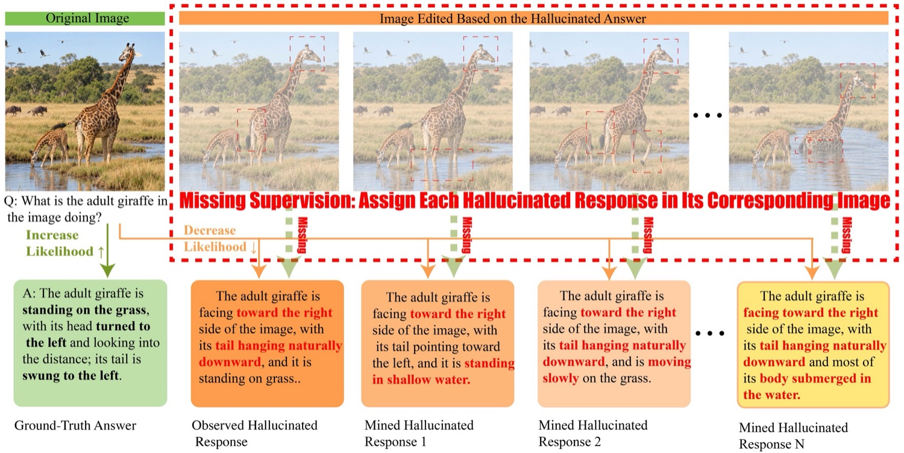
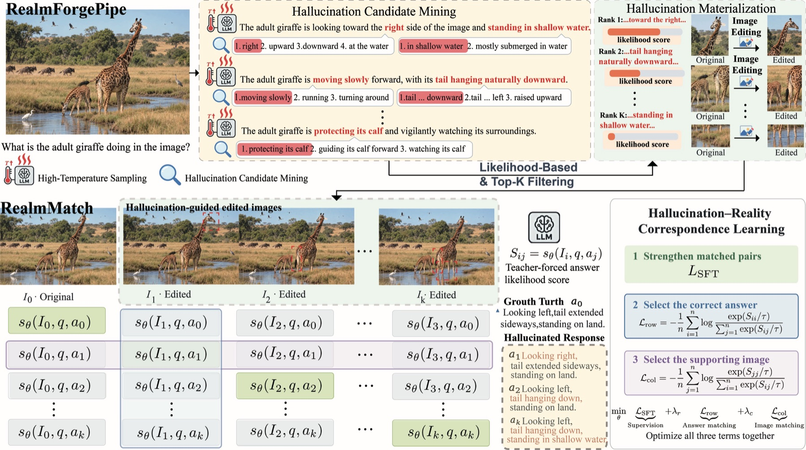
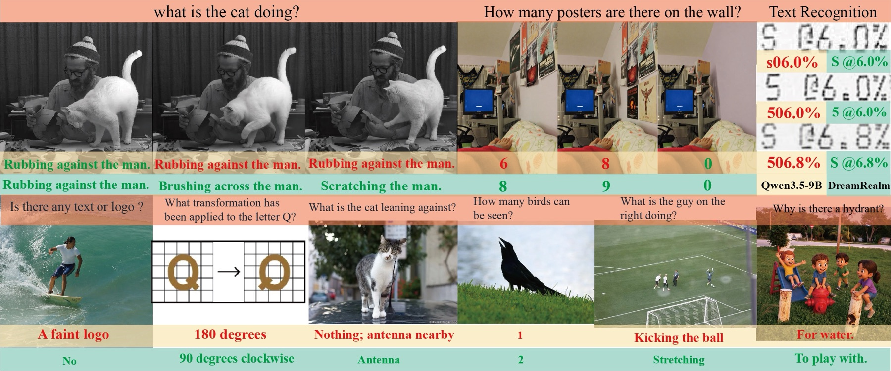

<div align="center">

# DreamRealm

### Exploring and Materializing Hallucination Worlds<br>for Trustworthy Vision-Language Models

<a href="https://arxiv.org/abs/2611.06433"></a>
<a href="https://huggingface.co/Alibaba-VELLDEPTH/Qwen35-9b-DreamRealm"></a>
<a href="LICENSE"></a>
<a href="docs/training.md"></a>
<a href="https://github.com/Alibaba-VELLDEPTH/DreamRealm/actions/workflows/checks.yml"></a>

**Benlei Cui\*** · **Chunyang Chai\*** · **Yiliang Zhang\*†** · Xiaoqian Xia<br>
Chengwen Yao · Song Li · Longtao Huang · Yuwen Zhai · Haiwen Hong†

**Yuvion Team, Alibaba Group**<br>
<sub>\* Equal contribution · † Corresponding authors · <a href="mailto:cuibenlei.cbl@alibaba-inc.com">Contact</a></sub>

[Paper](https://arxiv.org/abs/2611.06433) · [Overview](#overview) · [Results](#results) · [Model](#use-the-model) · [Training](#train-dreamrealm) · [Citation](#citation)

</div>

<p align="center">
  <a href="assets/motivation.jpg"></a>
  <br><sub>Exploring a model's hallucination worlds, materializing supporting images, and learning their correspondence.</sub>
</p>

> **What if a hallucinated answer were correct—in a different visual world?**
> DreamRealm turns a model's perceptual confusions into visual supervision: create images that support its hallucinated responses, then learn to match each response to the right image.

## Overview

DreamRealm is a post-training framework for improving visual perception and mitigating hallucinations in vision-language models. Rather than only suppressing unsupported answers under a fixed image, it learns **hallucination–reality correspondence** across original and edited images.

| Mine | Materialize | Match |
| :--- | :--- | :--- |
| Expose diverse perceptual errors through high-temperature sampling and likelihood-based selection. | Edit visual conditions so selected hallucinated responses become valid, with quality checks and human review. | Train on complete image–response families using matched-pair supervision and bidirectional contrastive learning. |

<p align="center">
  <a href="assets/framework.png"></a>
  <br><sub><b>RealmForgePipe</b> constructs hallucination-guided visual worlds. <b>RealmMatch</b> learns which response belongs to which world.</sub>
</p>

### Release at a glance

| Resource | Status |
| :--- | :--- |
| [Qwen35-9b-DreamRealm weights](https://huggingface.co/Alibaba-VELLDEPTH/Qwen35-9b-DreamRealm) | Available · Qwen3.5-9B-based · BF16 |
| RealmMatch local training implementation | Included in this repository |
| CPU correctness tests and smoke test | Included |
| [Paper / arXiv](https://arxiv.org/abs/2611.06433) | Available · arXiv:2611.06433 |
| RealmForgePipe construction pipeline, training data, distributed experiment launchers | Not included in this release |

## Results

Main-paper comparison under the manuscript's unified evaluation protocol. These are **reported paper results**, not scores recomputed by this repository's CPU tests. Scores use the paper's percentage scale; ↑ higher is better, ↓ lower is better.

| Benchmark / metric | Qwen3.5-9B | + DreamRealm |
| :--- | ---: | ---: |
| HallusionBench · aAcc ↑ | 70.95 | **78.21** |
| MMVP · item accuracy ↑ | 80.00 | **86.67** |
| MMVP · pair accuracy ↑ | 63.33 | **74.67** |
| AMBER · average accuracy ↑ | 88.34 | **91.01** |
| MMHal-Bench · hallucination rate ↓ | 47.92 | **27.08** |
| CV-Bench-2D · macro accuracy ↑ | 82.16 | **82.89** |
| ObjectHal · CHAIRs ↓ | 30.33 | **8.67** |

<p align="center">
  <a href="assets/qualitative.png"></a>
  <br><sub>Selected held-out examples. Yellow/mint bands denote Qwen3.5-9B / DreamRealm; red/green text marks incorrect/correct responses. Responses are condensed.</sub>
</p>

## Use the model

The checkpoint, tokenizer, processor, and chat template are hosted together on [Hugging Face](https://huggingface.co/Alibaba-VELLDEPTH/Qwen35-9b-DreamRealm). The release configuration records Transformers 5.3.0; **new installations use the repository's 5.10.4 dependency pin** to avoid the older version's known security advisories. See [security notes](SECURITY.md) and [compatibility boundaries](docs/reproducibility.md).

```bash
python -m pip install -r requirements.txt
python -m pip install huggingface_hub
hf download Alibaba-VELLDEPTH/Qwen35-9b-DreamRealm \
  --local-dir /models/Qwen35-9b-DreamRealm
```

See the [image inference example](docs/inference.md) for a local-image, non-thinking Transformers example. GPU memory needs depend on image resolution, sequence length, and generation settings.

## Train DreamRealm

### 1. Set up

Use Linux with a CUDA-capable GPU for real training. Install a PyTorch build appropriate for your CUDA environment before the remaining dependencies.

```bash
git clone https://github.com/Alibaba-VELLDEPTH/DreamRealm.git
cd DreamRealm
python -m venv .venv
source .venv/bin/activate
python -m pip install --upgrade pip
python -m pip install -r requirements.txt
```

### 2. Check the implementation on CPU

```bash
python scripts/local_smoke.py
python -m unittest discover -s tests -v
```

These checks cover the objective, replay gradients, CPU optimizer, family validation, vision freezing, and checkpoint integrity. They do **not** validate Qwen GPU memory fit or reproduce the paper's benchmarks.

### 3. Prepare complete families and train

Each JSONL record must contain a complete original/edited image–answer family. See the [data contract](docs/data-format.md); image paths may be absolute or relative to `--media-root`. Model and processor files must already be downloaded locally.

```bash
CUDA_VISIBLE_DEVICES=0 python train_dreamrealm.py \
  --model /models/Qwen3.5-9B \
  --data /datasets/dreamrealm/families.jsonl \
  --media-root /datasets/dreamrealm \
  --output /checkpoints/dreamrealm-run-001 \
  --epochs 3 --families-per-step 1 \
  --lr 5e-6 --lr-scheduler cosine --warmup-ratio 0.03 \
  --save-optimizer
```

**Implementation scope.** This entry point is a **single-GPU reference implementation** of RealmMatch, not the paper's distributed training launcher. It preserves the full-family objective with two-pass score replay and offloads FP32 AdamW master weights/states to CPU. It must not be launched with `torchrun`. CPU RAM and GPU memory should be measured on your actual families; no universal GPU-size guarantee is implied.

Read the [training guide](docs/training.md) for preflight, loss settings, outputs, resume, and failure modes, and the [reproducibility notes](docs/reproducibility.md) for the distinction between this implementation and the paper experiments.

## Repository map

```text
DreamRealm/
├── train_dreamrealm.py       # Single-GPU training entry point
├── dreamrealm/
│   ├── prepare.py           # Family validation and legacy pair conversion
│   ├── encoding.py          # Full-answer teacher forcing and cell scoring
│   ├── objective.py         # Matched SFT + row/column contrastive losses
│   ├── engine.py            # Two-pass replay and CPU-offloaded AdamW
│   ├── model_setup.py       # Vision-backbone freezing
│   └── checkpoint_io.py     # Checksummed, bounded-size checkpoint parts
├── scripts/local_smoke.py   # Lightweight CPU gradient smoke test
├── tests/                  # Correctness and checkpoint tests
├── docs/                   # Data, training, inference, reproducibility
└── assets/                 # Paper figures and project artwork
```

## Contributing

Bug reports and focused improvements are welcome. Please include a minimal reproduction and environment details, without uploading private images, training data, credentials, or checkpoints. See [CONTRIBUTING.md](CONTRIBUTING.md) for the development checks.

## Citation

If DreamRealm helps your research, please cite our paper:

```bibtex
@misc{cui2026dreamrealm,
  title  = {DreamRealm: Exploring and Materializing Hallucination Worlds for Trustworthy Vision-Language Models},
  author = {Benlei Cui and Chunyang Chai and Yiliang Zhang and Xiaoqian Xia and Chengwen Yao and Song Li and Longtao Huang and Yuwen Zhai and Haiwen Hong},
  year   = {2026},
  eprint = {2611.06433},
  archivePrefix = {arXiv},
  primaryClass = {cs.CV},
  url    = {https://arxiv.org/abs/2611.06433}
}
```

## License and acknowledgments

The code in this repository is licensed under [Apache-2.0](LICENSE). Model weights and third-party components remain subject to their respective licenses; consult the [model repository](https://huggingface.co/Alibaba-VELLDEPTH/Qwen35-9b-DreamRealm) and upstream releases.

Built on [Qwen3.5](https://huggingface.co/Qwen/Qwen3.5-9B), [Hugging Face Transformers](https://github.com/huggingface/transformers), and [PyTorch](https://github.com/pytorch/pytorch).

<div align="center"><sub>Yuvion Team · Alibaba Group</sub></div>
